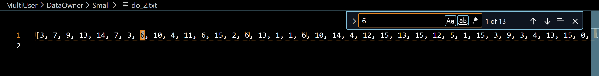
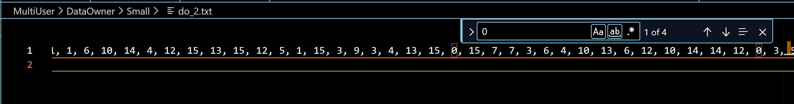
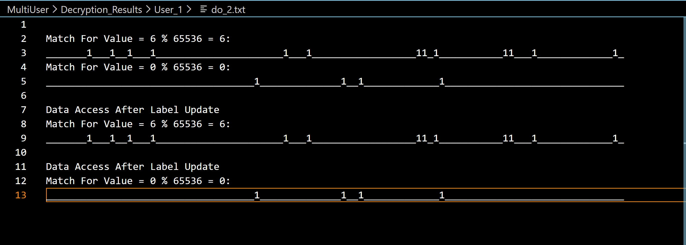

# Ace of SPADE — Functional Encryption Implementation

A Python implementation of the **Ace of SPADE (AoS)** functional encryption scheme, developed as a research reproduction project for the Security Protocols course at Tampere University.

The project implements lattice-based functional encryption algorithms, selective decryption, ciphertext updates, and a multi-user workflow.

## Overview

Ace of SPADE enables authorized users to perform selective equality checks on encrypted data without revealing the underlying plaintext values.

This implementation reproduces the scheme's main cryptographic operations using Python and NumPy, and extends them with a simulated multi-user environment involving a Key Center (KC), data owners, and users.

## Implemented Features

### Core Cryptographic Algorithms
- **Setup:** Generates functional encryption public and secret keys.
- **Encryption:** Encrypts data vectors under data-owner-specific labels.
- **Key Derivation:** Generates functional decryption keys for requested values.
- **Selective Decryption:** Identifies positions where encrypted values match a specified target.
- **Token Generation:** Generates tokens for updating ciphertext labels.
- **Ciphertext Update:** Updates encrypted data to a new label without decrypting the original plaintext.

### Multi-User Workflow
- Registration of multiple data owners and users.
- User-specific requests for selected data owners and target values.
- Generation and distribution of functional decryption keys.
- Simulated data access between users and the Key Center.
- Tracking of user registration and revocation status.

### Communication Security
- RSA-OAEP for asymmetric encryption.
- AES-GCM for authenticated encryption.
- RSA digital signatures for message authentication and integrity verification.
- Timestamp validation for signed messages.

### Performance Benchmarking
- Execution-time measurements for cryptographic operations.
- Memory-usage measurements using psutil.
- Experiments with four parameter configurations.

## Technologies

- **Language:** Python
- **Libraries:** NumPy, cryptography, PyCryptodome, psutil
- **Concepts:** Functional Encryption, Lattice-Based Cryptography, Selective Decryption, Cryptographic Protocols

## Implementation Details

The implementation uses:

- Negacyclic polynomial multiplication
- Ternary polynomial sampling
- Gaussian noise sampling
- Modular polynomial arithmetic
- Functional key generation and equality-based decryption

The cryptographic arithmetic is implemented with NumPy rather than a specialized lattice-cryptography library.

## Experimental Evaluation

Experiments were conducted using four configurations from the reference paper.

| Configuration | Vector Size | Ring Degree |
|---------------|-------------|-------------|
| Small | 100 | 4096 |
| Medium | 200 | 8192 |
| Large | 500 | 16384 |
| Extra Large | 1000 | 32768 |


## Demonstration

### Selective Decryption

The following screenshots highlight the positions of target values in the original plaintext dataset.

**Target value: 6**



**Target value: 0**



### Ciphertext Update Verification

The implementation performs selective decryption before and after updating the ciphertext label, preserving the expected matching results.




### Observations

- Selective decryption was tested against expected plaintext equality matches.
- Ciphertext-label updates preserved the expected matching results in the reported experiments.
- Execution time and memory requirements generally increased with larger parameter configurations.
- Performance was compared with the reference paper, which used an optimized Go implementation.

## Installation

Requires Python 3 and the following dependencies:

```bash
pip install numpy cryptography pycryptodome psutil
```

## Usage

Run the application:

```bash
python sec_prot.py
```

The interactive program allows users to:

1. Select a cryptographic parameter configuration.
2. Register users and specify data owners.
3. Choose target values for selective decryption.
4. Access encrypted data through the simulated Key Center.
5. Observe decryption results before and after ciphertext-label updates.

Generated files are organized into:

- `DataOwner/` — generated plaintext datasets
- `KC/` — encrypted data stored by the Key Center
- `Decryption_Results/` — selective decryption outputs

## Project Files

| File | Description |
|------|-------------|
| `sec_prot.py` | Functional encryption algorithms, multi-user workflow, and benchmarking |
| `utils.py` | AES/RSA operations, digital signatures, and message utilities |

## Reference

Hadjeres, M., Nuoskala, C., Abdinasibfar, H., and Michalas, A. (2025).

*Ace of SPADE: Selective and PArtial DEcryption with Post-Quantum Security.*

## Disclaimer

This is an educational research implementation, not a production-ready cryptographic library. It has not been independently audited or formally verified.
